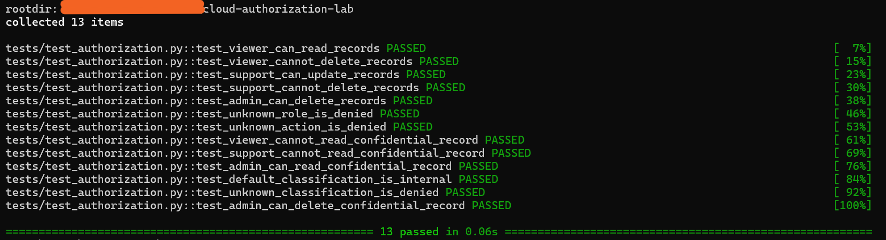
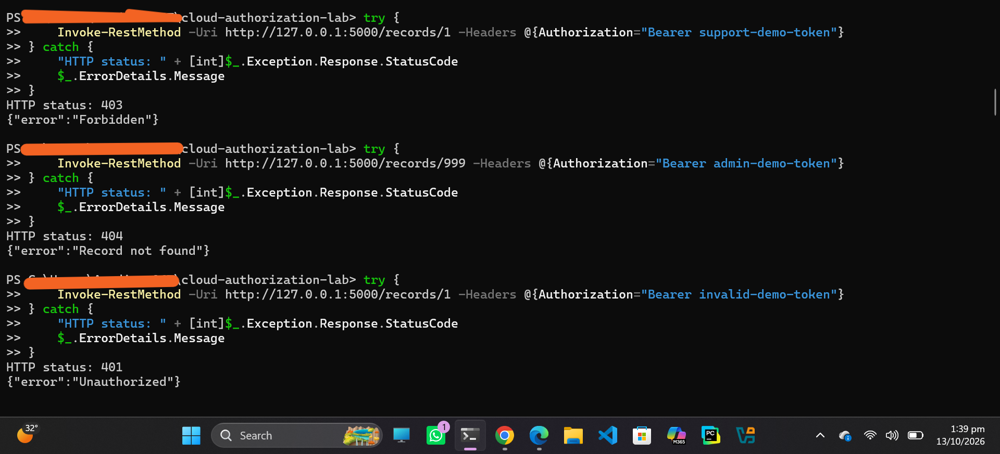
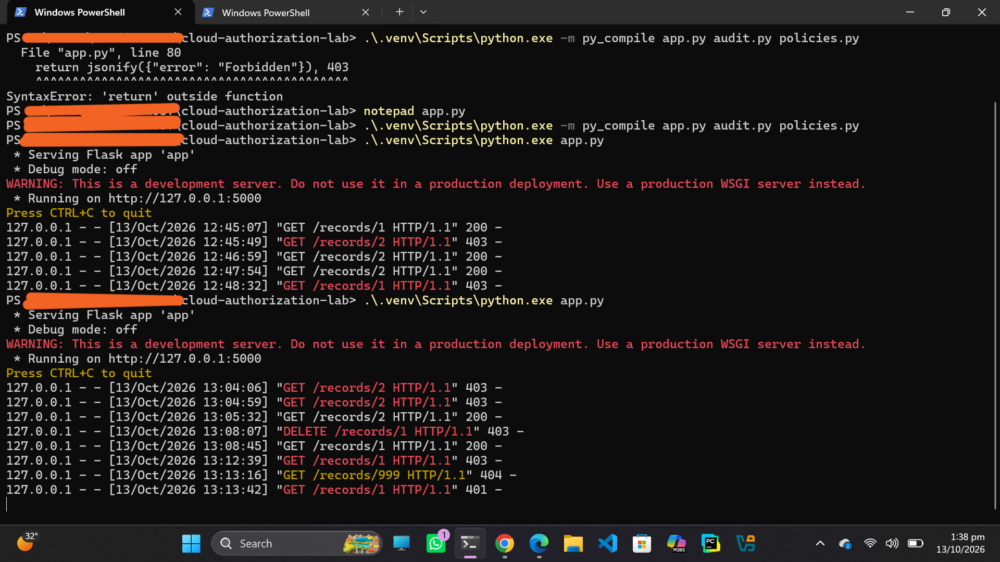
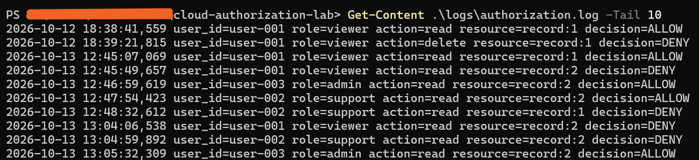

\# Cloud Authorization Lab


A local educational cloud-security lab demonstrating role-based access control (RBAC), attribute-based access control (ABAC), resource ownership checks, audit logging, and automated authorization tests using Python and Flask.


\## Features


\- \*\*RBAC:\*\* Viewer, support, and admin roles with different permissions.

\- \*\*ABAC:\*\* Access decisions based on record classification.

\- \*\*Resource ownership:\*\* Restricts access to records owned by other users, except for the defined admin role.

\- \*\*Fail-closed classification handling:\*\* Unknown classifications are denied.

\- \*\*Audit logging:\*\* Records authorization decisions.

\- \*\*Automated tests:\*\* Pytest tests for role permissions and classification rules.


\## Technology Stack


\- Python

\- Flask

\- Pytest


\## Project Structure


```text

cloud-authorization-lab/

├── app.py

├── policies.py

├── audit.py

├── requirements.txt

├── tests/

│   └── test\_authorization.py

├── logs/

└── .gitignore

```


\## Run Locally


1\. Clone this repository.

2\. Create and activate a Python virtual environment.

3\. Install dependencies:


&#x20;  ```bash

&#x20;  pip install -r requirements.txt

&#x20;  ```


4\. Start the application:


&#x20;  ```bash

&#x20;  python app.py

&#x20;  ```


5\. The API listens on `127.0.0.1:5000`.


\## Demo API


The lab includes predefined demo identities for local testing only.


Example request:


```bash

curl -H "Authorization: Bearer viewer-demo-token" http://127.0.0.1:5000/records/1

```


Expected behavior includes:

\- `200 OK` when access is allowed.

\- `401 Unauthorized` for an invalid or missing token.

\- `403 Forbidden` when authorization is denied.

\- `404 Not Found` when the requested record does not exist.


\## Run Tests


```bash

python -m pytest -v

```


At the time of writing, all 13 authorization policy tests pass.

## Evidence and Test Results

This section demonstrates the practical implementation and testing of the Cloud Authorization Lab through automated tests, manual API requests, and authorization logging.

### 1. Automated Authorization Tests

The project includes 13 automated tests covering role-based permissions, confidential record access, unsupported roles and actions, and default-deny behavior. All 13 tests passed in the recorded test run.



### 2. Manual API Testing

Manual testing was performed by sending API requests and inspecting the responses. This helps verify how the application handles permitted and denied access according to its authorization policies.



### 3. Runtime Authorization Logs

The running application produces log output when API endpoints are accessed. These logs help observe application activity and authorization decisions during testing.



### 4. Authorization Audit Log

Authorization audit entries are stored in `logs/authorization.log`. These entries record allowed and denied authorization decisions, helping with review and troubleshooting.



**Note:** This project is an educational lab that runs locally. The screenshots show results observed during testing and do not represent a production deployment or independent security audit.


\## Security Notes and Limitations


\- This is a local educational project, not a production-ready authorization service.

\- Demo bearer tokens are hardcoded and must never be used in production.

\- The records are in memory and reset when the application restarts.

\- The lab does not implement a real cloud-provider integration.

\- Only use this lab and its techniques in systems you own or are explicitly authorized to test.


\## Learning Objectives


This project demonstrates practical understanding of authorization policies, least privilege, resource ownership, fail-closed decisions, audit logging, and automated security testing.

